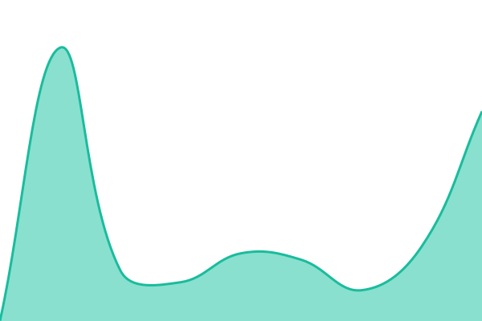
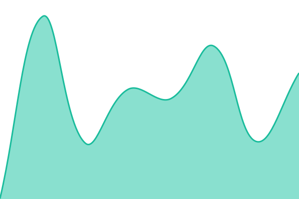
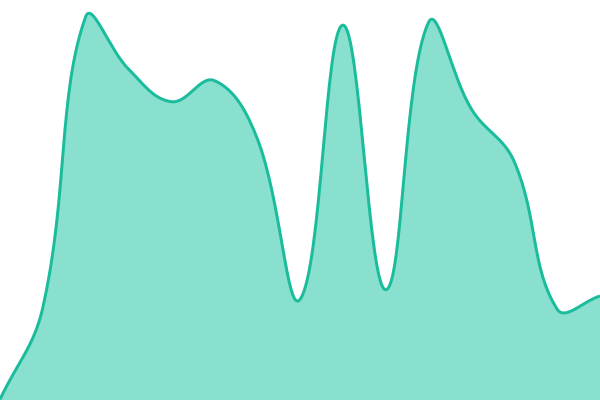

# [📈 Live Status](https://status.daltonsbio.com): <!--live status--> **🟩 All systems operational**

This repository contains the open-source uptime monitor and status page for [dalton-projects](https://status.daltonsbio.com), powered by [Upptime](https://github.com/upptime/upptime).

With [Upptime](https://upptime.js.org), you can get your own unlimited and free uptime monitor and status page, powered entirely by a GitHub repository. We use [Issues](https://github.com/dalton-projects/daltonsbio-status/issues) as incident reports, [Actions](https://github.com/dalton-projects/daltonsbio-status/actions) as uptime monitors, and [Pages](https://status.daltonsbio.com) for the status page.

<!--start: status pages-->
<!-- This summary is generated by Upptime (https://github.com/upptime/upptime) -->
<!-- Do not edit this manually, your changes will be overwritten -->
<!-- prettier-ignore -->
| URL | Status | History | Response Time | Uptime |
| --- | ------ | ------- | ------------- | ------ |
|  [Website](https://www.daltonsbio.com) | 🟩 Up | [website.yml](https://github.com/dalton-projects/daltonsbio-status/commits/HEAD/history/website.yml) | 

 359ms
     
 | 

<a href="https://dalton-projects.github.io/daltonsbio-status/history/website">100.00%</a>
    

|  [Signing in](https://www.daltonsbio.com/api/health?part=database) | 🟩 Up | [signing-in.yml](https://github.com/dalton-projects/daltonsbio-status/commits/HEAD/history/signing-in.yml) | 

 0ms
     
 | 

<a href="https://dalton-projects.github.io/daltonsbio-status/history/signing-in">100.00%</a>
    

|  [Buying a course](https://www.daltonsbio.com/api/health?part=payments) | 🟩 Up | [buying-a-course.yml](https://github.com/dalton-projects/daltonsbio-status/commits/HEAD/history/buying-a-course.yml) | 

 292ms
     
 | 

<a href="https://dalton-projects.github.io/daltonsbio-status/history/buying-a-course">100.00%</a>
    

|  [Lessons](https://www.daltonsbio.com/api/health?part=lessons) | 🟩 Up | [lessons.yml](https://github.com/dalton-projects/daltonsbio-status/commits/HEAD/history/lessons.yml) | 

 567ms
     
 | 

<a href="https://dalton-projects.github.io/daltonsbio-status/history/lessons">100.00%</a>
    

<!--end: status pages-->

[**Visit our status website →**](https://status.daltonsbio.com)

## 📄 License

- Powered by: [Upptime](https://github.com/upptime/upptime)
- Code: [MIT](./LICENSE) © [Anand Chowdhary](https://anandchowdhary.com)
- Data in the `./history` directory: [Open Database License](https://opendatacommons.org/licenses/odbl/1-0/)
